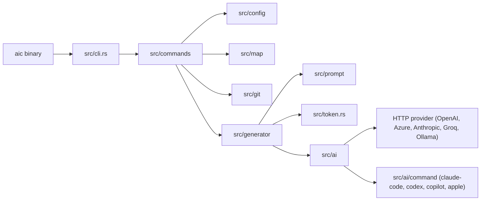
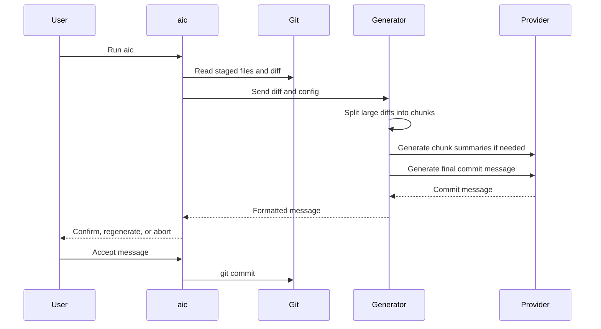

# Architecture

The Rust crate is organized around small modules:

```text
src/cli.rs              CLI parser and dispatch
src/cli_help.toml       Bundled help text and config-key descriptions
src/commands/           User-facing command flows
src/config/             Defaults, global config, loading, parsing, validation, and persistence
src/git/                Git command wrapper, repo helpers, branch logic, remotes, and hooks
src/ui.rs               Terminal styling layer: sections, steps, cards, spinners, prompt theme
src/tui/                Full-screen terminal UI (aic --tui): state, rendering, theme, diff highlighting
src/output.rs           Machine-readable output for --json and --quiet
src/prompt/             Prompt builders, prompt-template interpolation, and response cleanup
src/token.rs            Token counting and diff splitting
src/generator/          Prompt, chunking, and AI engine orchestration
src/history_store/      Commit and review history persistence
src/map/                SVG visualization renderers (treemap, timeline, heatmap, activity)
src/ai/                 Provider trait and provider implementations
src/ai/command/         Command-backed provider execution (claude-code, codex, copilot, apple)
src/ai/sse.rs           Server-sent events parser for streaming HTTP providers
src/git/diff.rs         Hunk-level staged-diff model and index operations for split commits
```

The `aic` binary calls the shared library entrypoint.



Provider implementations use an `AiEngine` trait that accepts normalized chat messages and returns the model's text (`complete`). `complete_streaming` reports text fragments to a callback as they arrive; the default implementation calls `complete` and reports one fragment, and the OpenAI-compatible and Anthropic engines override it with server-sent events. Only the request that produces the final commit message streams. This keeps the commit flow independent of transport details such as HTTP payloads or local subprocess execution.

Current provider families:

- OpenAI-compatible HTTP engines for `openai`, `azure-openai`, `groq`, and `ollama`
- Anthropic Messages API engine for `anthropic`
- Command-backed engines for `claude-code`, `codex`, `copilot`, and `apple`. Most receive a flattened transcript over stdin; `apple` (`fm respond`) uses an instructions flag instead, so the system prompt and few-shot turns go through `-i` and only the final user message is piped in.

Git behavior is isolated behind the `src/git/` module family so commit, push, hooks, staged-file discovery, branch/base-ref logic, and ignore-file filtering are testable without mixing Git process logic into UI commands.

In `--json` / `--quiet` mode `ui::set_machine_output(true)` silences every line, card, and spinner from `src/ui.rs` and makes its prompts return an error, so stdout carries only the result printed by `src/output.rs`.

All terminal output goes through `src/ui.rs`, the single styling layer: `◇` section headers, dim `•` session steps, bordered cards, status spinners, and the inquire prompt theme. Sections and cards insert their own leading blank line via an internal last-line tracker, so command flows never manage vertical spacing; the one rule is to `finish_and_clear` any live spinner before printing. `ui::hyperlink` wraps text in an OSC-8 terminal hyperlink with a plain-text fallback (and must never be used inside card bodies, where wrapping can split a multi-word link across the fixed-width borders).

The largest command and support modules are now folderized to keep responsibilities local without changing public module paths:

- `src/commands/commit/` separates staging, split-commit flow, push handling, and shared helpers behind `commands::commit::run`.
- `src/commands/history/` separates formatting, rendering, and interactive browsing behind `commands::history::run`.
- `src/config/` preserves `crate::config::*` while splitting model defaults, loading, parsing, validation, and writing.
- `src/generator/` preserves `crate::generator::*` while separating commit, PR, and split-plan generation flows.
- `src/prompt/` preserves `crate::prompt::*` while separating commit, review, split, PR, and sanitization helpers.
- `src/history_store/` keeps history persistence separate from the `aic history` command module.
- `src/ai/command/` keeps command-backed provider execution separate from command resolution and test helpers.
- `src/commands/map/` separates the four visualization subcommands (`tree`, `history`, `heat`, `activity`) behind `commands::map`.
- `src/map/` provides SVG rendering: treemap layout, timeline layout, heatmap bars, activity grid, palette helpers, and SVG element utilities.

As a maintenance rule, modules that start combining multiple distinct concerns should usually graduate from a single `*.rs` file into a folder with a `mod.rs` compatibility layer and focused submodules.

Prompt templates live in `prompts/`:

- `commit-system.md` - system prompt for commit message generation. Supports scope hints derived from staged file paths.
- `commit-system-apple.md` - compact commit prompt for the `apple` provider's small on-device model. It has no style examples (the model copies them) and tells the model not to restate the contents of added files as changes.
- `split-system.md` - system prompt for grouping the hunks of one staged change set into multiple commits. Hunks are referenced by `path#n` IDs from `src/git/diff.rs`.
- `review-system.md` - system prompt for `aic review` diff analysis.

Use `AIC_PROMPT_FILE` to point at a custom commit prompt template.

## Hunks and split commits

`src/git/diff.rs` parses `git diff --cached` (run with fixed flags so user `diff.*` settings cannot change the format) into files and hunks. Each hunk has an ID of the form `path#n`; new, deleted, renamed, copied, mode-changed, and binary files are a single atomic hunk. `StagedDiff::patch_for` builds a patch from any subset of hunk IDs, and `annotated` produces the diff the split prompt sees, with a `### hunk path#n` marker above each hunk.

Split commits are created from an index snapshot: `git write-tree`, then for each group `git read-tree HEAD` (or `--empty`), `git apply --cached` with the group's patch, and `git commit`. The snapshot is restored with `git read-tree` afterwards, on success or failure. The working tree is never written.

## Terminal UI

`src/tui/` is a second frontend for the commit flow, built with `ratatui` and `crossterm`:

- `app.rs` holds state and handles keys, mouse events, and background-task events. Generation runs in `tokio` tasks that send progress, streamed text, and results over an unbounded channel, so the UI never blocks.
- `view.rs` renders each frame and records hit-test rectangles for mouse input.
- `highlight.rs` renders hunks with add/remove tints, word-level changes, and a small keyword/string/comment highlighter.
- `theme.rs` derives colours from the `aic map` themes and falls back to the xterm-256 palette without truecolor.
- `editor.rs` is the inline message editor.

The TUI only stages and unstages (through `src/git`); it never commits. It returns an `Outcome` (commit, split, or quit), and `commands::commit` performs it with the same commit, split, history, and push code as the prompt flow.

## Commit Generation Flow


